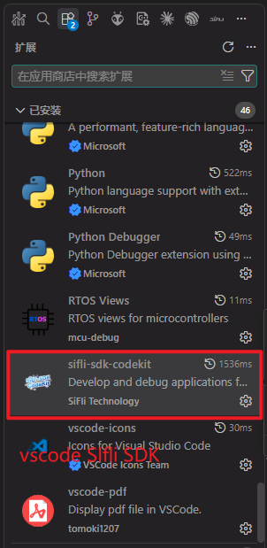
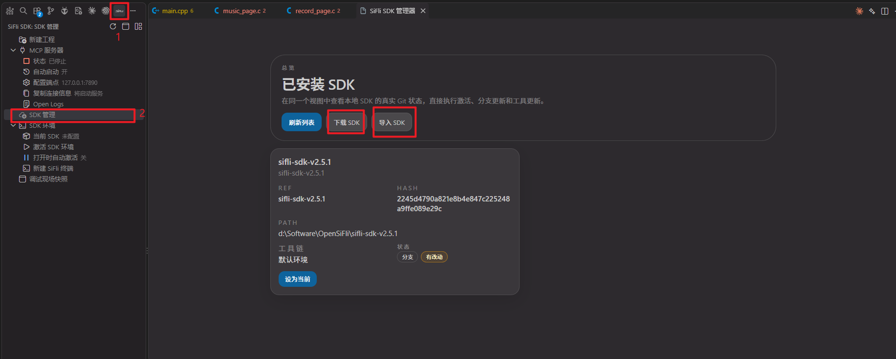
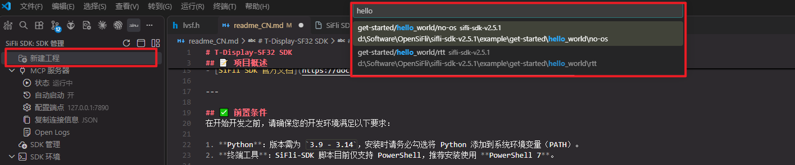
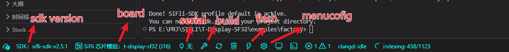
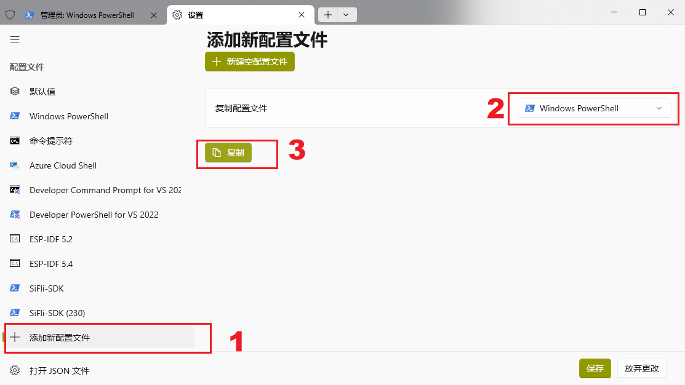
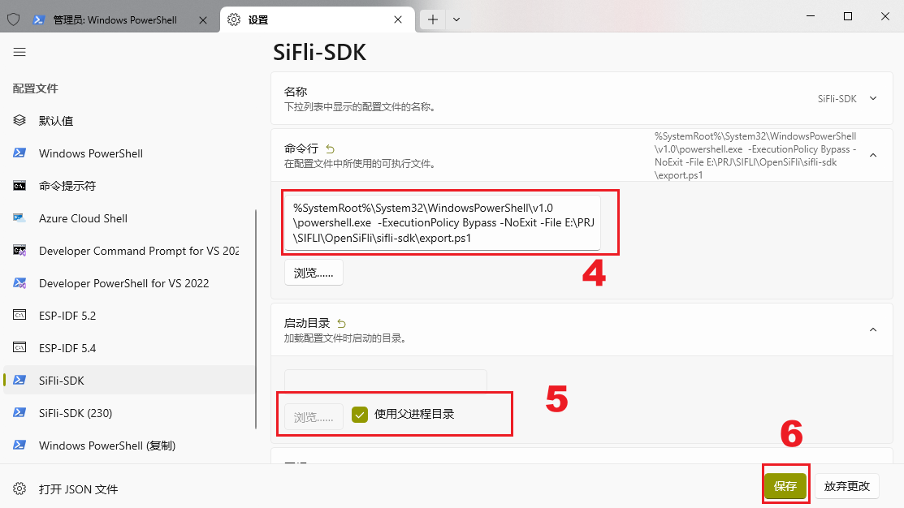
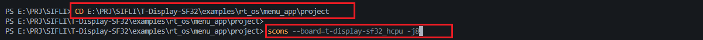
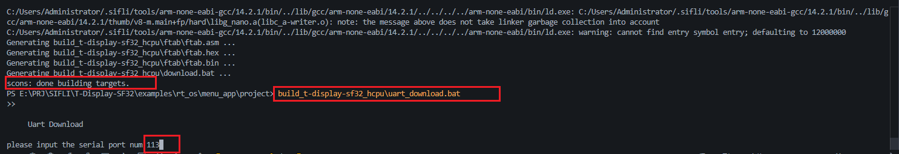

# T-Display-SF32 SDK

## 📝 Project Overview
This project is the official SDK for **T-Display-SF32**, developed based on `SiFli SDK (2.4.0)`, aiming to help developers quickly get started and develop applications for T-Display-SF32.

**Core Directory Description:**
- `sifli-sdk/customer/boards`: Board-level configuration files
- `sifli-sdk/examples`: Official peripheral driver examples
- `sifli-sdk/t_sf32_display_hw_device`: T-Display-SF32 exclusive hardware drivers
- `sifli-sdk/middleware`: Official middleware
- `sifli-sdk/external`: Official third-party libraries

📚 **Supporting Documentation:**
- [SiFli Wiki](https://wiki.sifli.com/)
- [SiFli SDK Official Documentation](https://docs.sifli.com/projects/sdk/latest/sf32lb52x/index.html)

---

## ✅ Prerequisites
Before starting development, ensure your development environment meets the following requirements:

1. **Python**: Version `3.9 - 3.14`. When installing, make sure to check the option to add Python to the system environment variables (PATH).
2. **Terminal Tool**: SiFli-SDK scripts currently only support PowerShell. It is recommended to install and use **PowerShell 7**.

---

## 🛠️ Environment Setup and Configuration

### VS Code Extension (Recommended)
> Note: You must select the **LILYGO-SIFLI-SDK** package to support the `t-display-SF32` board option. The official SDK does not support this hardware.

#### 1. Obtain the SDK
Download this SDK and extract it to any directory, for example: `D:\T-Display-SF32\SDK`.

#### 2. Install the VS Code Extension
Search for and install `sifli-sdk-codekit` in the VS Code Extensions marketplace.


#### 3. Import the SDK
Open SDK Manager, select Import SDK, enter the SDK path, and click Start Import. Wait for the installation to complete.


#### 4. Create a Project
Open the `sifli-sdk-codekit` extension and select Create Project. Available examples will be displayed. Search for the example you want to build and select it to create a project.


#### 5. Configure the Board
Open the newly created project. The SiFli extension automatically detects the project and displays options such as SDK, chip module, serial port, build, flash, and menuconfig in the lower-left corner. Select the `t-display-SF32` board under Chip Module, select the device serial port, and then build and flash the firmware.


### Terminal
#### 1. Obtain the SDK
Download this SDK and extract it to any directory, for example: `D:\T-Display-SF32\SDK`.

#### 2. Configure the PowerShell Terminal Environment
1. Open Windows Terminal and press `Ctrl + ','` to open settings.
2. Click **Add a new profile** and select **Duplicate Windows PowerShell**.
3. Modify the settings of the new profile:
   - **Name**: Change to `SiFli-SDK`
   - **Starting Directory**: Select **Use parent process directory**
   - **Command Line**: Use the following format, replacing the `export.ps1` path with the actual path where you extracted the SDK:
     ```powershell
     %SystemRoot%\System32\WindowsPowerShell\v1.0\powershell.exe -ExecutionPolicy Bypass -NoExit -File D:\T-Display-SF32\SDK\sifli-sdk\export.ps1
     ```



---

#### 3. Build and Flash
Use the `SiFli-SDK` terminal configured in the previous step to perform the following operations:

##### 3.1 Enter the Project Directory
```powershell
cd sifli-sdk\example\rt_driver\project
```

##### 3.2 Build the Project
Use the following command to build the project (`-j16` uses 16 threads to accelerate the build; adjust it according to your computer's configuration):
```powershell
scons --board=t-display-sf32_hcpu -j16
```


##### 3.3 Flash the Firmware
After the build is complete, execute the following batch file to enter flashing mode, then follow the prompts to enter the device's port number:
```powershell
build_t-display-sf32_hcpu\uart_download.bat
```


#### 4. Menu Configuration (Optional)
If you need to modify the project configuration, run the following command to open the menuconfig interface:
```powershell
scons --board=t-display-sf32 --menuconfig
```

---

## 📜 License Information
This project follows the corresponding open-source license. For specific information, please refer to the SDK source code and the LICENSE file in the `sifli-sdk` directory. Development using the SiFli SDK must comply with SiFli's official licensing agreements.

---

## 💡 Additional Information
- **Common Issues**: If you encounter Python-related errors, first check whether the Python version and environment variables are configured correctly. If you encounter build errors, check whether the terminal is the dedicated PowerShell with `export.ps1` loaded.
- **Technical Support**: For more information on low-level drivers and peripheral usage, refer to the official example code in the `examples` folder and the official documentation.
- **Update to the Latest SDK Version**: See [update_sdk.md](./update_sdk_install.md).
